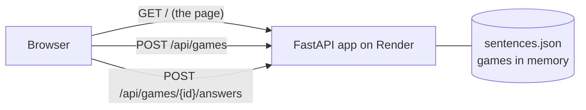

# Guess the Language

A small web game: read a sentence and guess whether it's English, German or Spanish. Ten rounds per game.

I'm building it in stages to learn how to deploy software properly. Each stage adds one deployment skill, and the last one adds AI.

**Live:** https://YOUR-SERVICE.onrender.com *(replace with your Render link)*

## Roadmap

- [x] **Stage 1 – Static site.** One HTML page, deployed on GitHub Pages.
- [x] **Stage 2 – Python backend.** A FastAPI app on Render checks answers and keeps score, so the browser can't cheat.
- [ ] **Stage 3 – Database.** A global leaderboard stored in Postgres.
- [ ] **Stage 4 – Docker + CI/CD.** Tests run on every push; the app deploys only if they pass.
- [ ] **Stage 5 – Observability.** Structured logs, error tracking, uptime checks.
- [ ] **Stage 6 – AI.** A trained model guesses along with the player; later an LLM writes new sentences.

## How it works



1. The browser loads the page from the server.
2. **Start a game:** the server picks 10 random sentences and sends back only the first sentence's text, never its language.
3. **Answer:** the browser sends a guess. The server checks it, updates the score and returns the result plus the next sentence.

In Stage 1 every answer was in the page source, so anyone could open the developer tools and cheat. Now the answers only exist on the server.

```
guess-the-language/
├── app/
│   ├── main.py            # the API: endpoints and game logic
│   └── sentences.json     # the 30 sentences and their languages
├── static/
│   └── index.html         # the game page
├── tests/
│   └── test_api.py        # automated tests
├── requirements.txt       # what the server installs
├── requirements-dev.txt   # extra tools for testing locally
├── .python-version        # tells Render which Python to use
└── README.md
```

## Run it locally

You need Python 3.12 or newer.

```bash
# 1. Create and activate a virtual environment (a private folder of packages for this project)
python -m venv .venv
source .venv/bin/activate        # Windows: .venv\Scripts\activate

# 2. Install the packages
pip install -r requirements-dev.txt

# 3. Run the tests
pytest

# 4. Start the server
uvicorn app.main:app --reload
```

Then open:
- http://localhost:8000 to play
- http://localhost:8000/docs for interactive API docs, generated automatically by FastAPI. You can call the endpoints from there.
- http://localhost:8000/health for the health check

`--reload` restarts the server whenever you save a file. Stop it with `Ctrl+C`.

## Deploy to Render

1. Push the code to GitHub (see "Updating" below).
2. Sign up at [render.com](https://render.com) with your GitHub account.
3. Click **New → Web Service** and pick the `guess-the-language` repository.
4. Fill in the settings:
   - **Language:** Python 3
   - **Build command:** `pip install -r requirements.txt`
   - **Start command:** `uvicorn app.main:app --host 0.0.0.0 --port $PORT`
   - **Instance type:** Free
   - **Health check path:** `/health` (under Advanced, if you see it)
5. Click **Create Web Service** and watch the logs. When you see the app start, your link is at the top of the page.

**Why `--host 0.0.0.0 --port $PORT`?** Locally the server only listens on your own machine on port 8000. On Render it has to accept traffic from outside, on whatever port Render assigns through the `PORT` environment variable.

## Updating

Every push to `main` triggers a new deploy on Render automatically:

```bash
git add .
git commit -m "Describe what you changed"
git push
```

Watch it in the **Events** and **Logs** tabs of your service on Render.

## Known limitations

These are deliberate trade-offs for now, and later stages fix them:

- **Games live in memory.** If the server restarts, games in progress are lost and the page asks you to start a new one. Stage 3 adds a database.
- **The free instance sleeps** after 15 minutes without visitors. The first visit afterwards takes about a minute while Render shows a loading page.
- **One server only.** In-memory games wouldn't work with several servers behind a load balancer, since each would have its own memory. A database solves this too.

## What I learned

*(Fill this in as you go. Note anything that broke and how you fixed it. It's the most interesting part for anyone reading.)*
